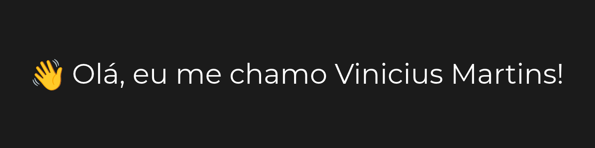

<h3>
    📈 Desenvolvedor em constante evolução
</h3>

    Focado em tecnologia, desenvolvimento de projetos e soluções para problemas do mundo digital. Estou constantemente aprimorando minhas habilidades através de estudos diários, projetos próprios e construindo na prática aquilo que venho aprendendo.

---

<h3>
    🔧 Ferramentas que utilizo
</h3>

    
    
    
    
    
    
    
    
    

---

<h3>

    
🎓 Certificações

        <ul>
            

                
🅰️ Alura

                    

                        
📑 HTML & CSS

                            <ul>
                                    <li><a href="https://cursos.alura.com.br/certificate/9e8d9637-0c9a-4bcb-92a5-80d2e5c8d116?lang=pt_BR">Cabeçalho, footer e variáveis CSS</a><li>
                                    <li><a href="https://cursos.alura.com.br/certificate/45105b21-3f24-4080-a55b-7fe52daa86c9?lang=pt_BR">Classes, posicionamento e Flexbox</a></li>
                                    <li><a href="https://cursos.alura.com.br/certificate/a2fe6c95-4b8a-469e-87b1-2052694bd8bf?lang=pt_BR">Ambientes de desenvolvimento, estrutura de arquivos e tags</a></li>
                                    <li><a href="https://cursos.alura.com.br/certificate/76a50af1-9eb2-419b-9c04-e2c42e6a9943?lang=pt_BR">Trabalhando com responsividade e publicação de projetos</a></li>
                            </ul>
                    

            

        <ul>

</h3>